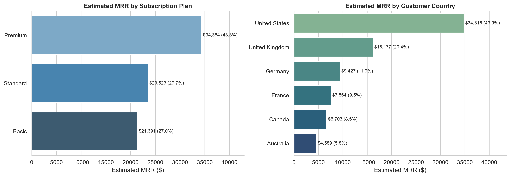
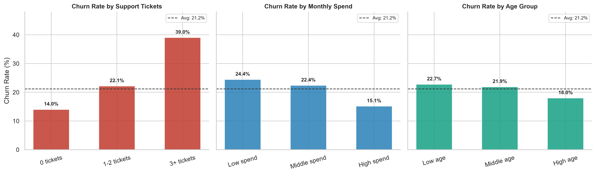
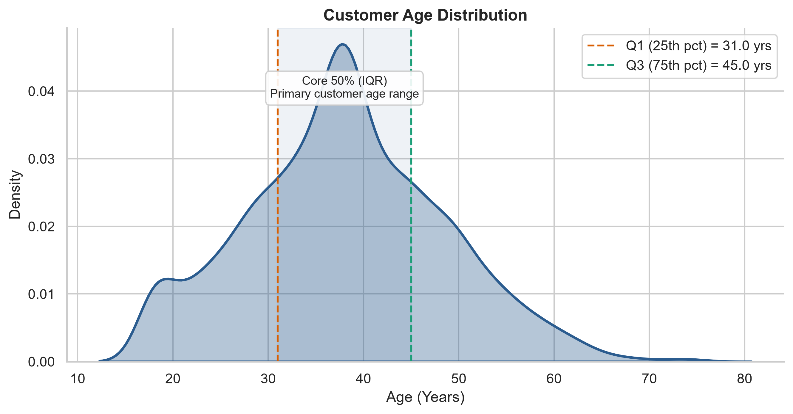
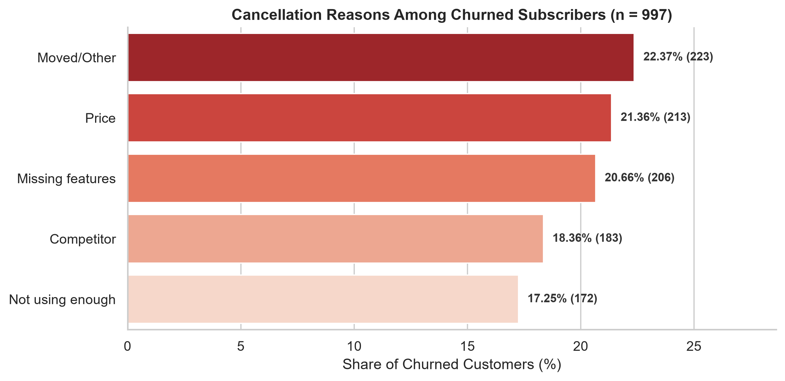

Customer Churn & Revenue Analysis for a Subscription Business

Cleaning a messy CRM export, showing where recurring revenue comes from, and identifying which customers are most likely to leave, with a written report for non-technical readers.

Business questions
Where does recurring revenue come from (by plan and by country)?
Who are the customers?
What stands out about the customers who left?
Key results
Area	Result
Estimated active MRR	$79,278 (Premium 43%, Standard 30%, Basic 27%)
Largest markets	United States 44% of MRR, United Kingdom 20%
Overall churn	21.2% (997 of 4,708 customers with a known status)
Support tickets	Churn rises from 14% (0 tickets) to 22% (1-2) and 39% (3+). Effect size: small-to-medium (Cohen's w = 0.17)
Monthly spend	Churn is 24.4% in the lowest spend band versus 15.1% in the highest. Spend is largely set by plan
Age	22.8% (31 or younger) to 18.0% (over 45). Statistically detectable but negligible (w = 0.045)

The full write-up, with tables, caveats and recommendations, is in the report: Customer_Churn_Revenue_Analysis.docx.

Figures

Approach

1. Data cleaning (every decision is documented in the report):

Issue in the raw export	Treatment
144 duplicate customer IDs	Kept the first record per ID
9999 placeholder spend values (15), one extreme value, $ signs, blanks, N/A	Flagged as missing, imputed with the median by plan and country
Three date formats (ISO, day-first slash dates, text dates)	Parsed all three; day-first confirmed by 707 unambiguous values against none month-first
Inconsistent country labels (1,470 rows)	Mapped to 6 canonical countries
Impossible or missing ages (324 rows, 6.8%)	Set to missing, imputed with group medians
Mixed churn labels and 92 blanks	Standardised to 0/1; blanks excluded from churn rates

2. Revenue attribution: estimated MRR = sum of the current monthly spend of active customers, broken down by plan and country.

3. Churn analysis: churn rates by support tickets, age group and spend band, tested with chi-square tests of independence and Cohen's w as effect size, so that statistical significance is not mistaken for practical importance.

Limitations
Observational, single snapshot: associations, not causes. There are no cancellation dates, so time-to-churn cannot be modelled.
Tenure is not compared between active and churned customers because it is tied to churn status by definition.
Imputed values (94 spend values, 324 ages) slightly understate natural variation. Customers with a missing or impossible age churned at about 40% versus about 20% for the rest, so the age results are approximate.
Subscription plan, country and engagement (sessions) are natural follow-up segments that are not covered here.
How to run
bash
pip install pandas numpy scipy matplotlib seaborn

Python 3.10+ is required. Then, in the notebook or script:

python
import pandas as pd

df = pd.read_csv("job1_subscribers_raw.csv")   # path to the raw synthetic export

df_clean = clean_data(df)                      # cleaning + audit report

data_info(df_clean)                            # revenue, churn and statistical tests
Skills demonstrated

Python, pandas, data cleaning and auditing, exploratory data analysis, hypothesis testing (chi-square, effect size), data visualisation, business reporting.

Author
<your name>
